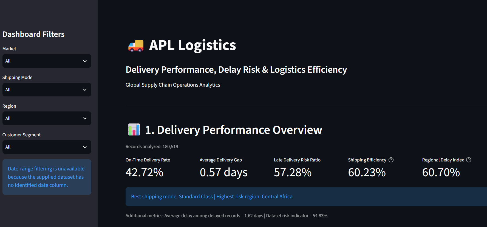
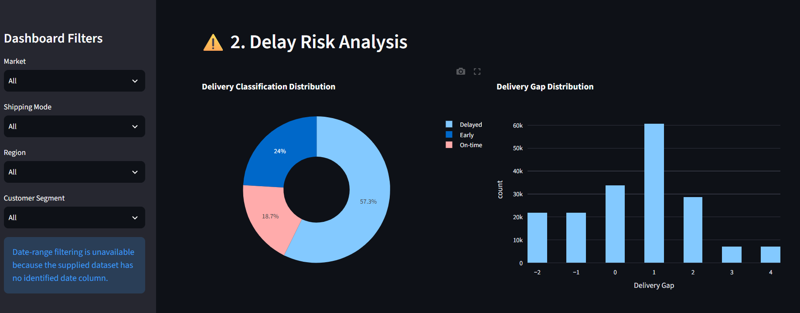
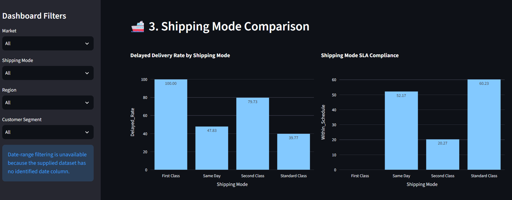
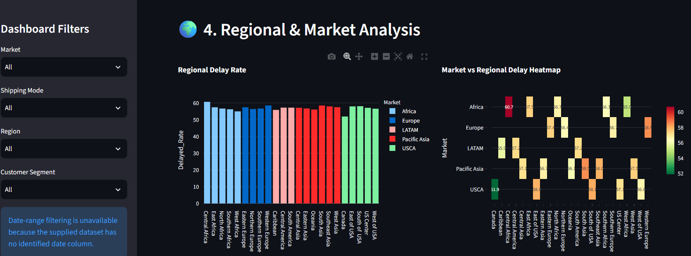
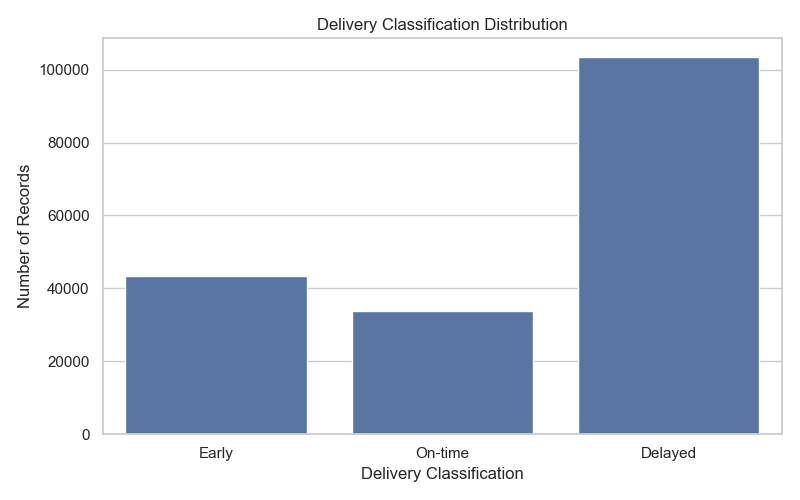
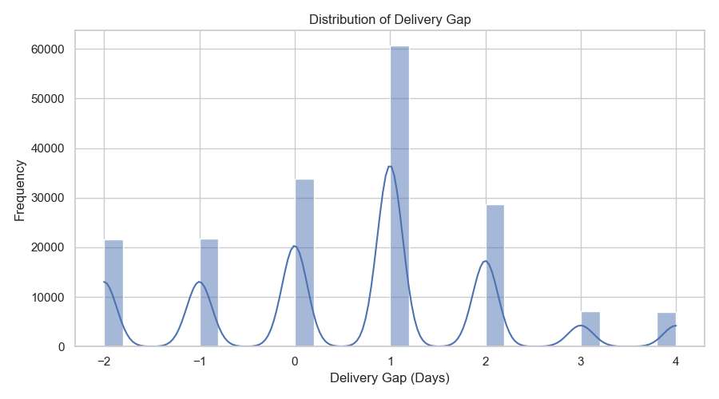
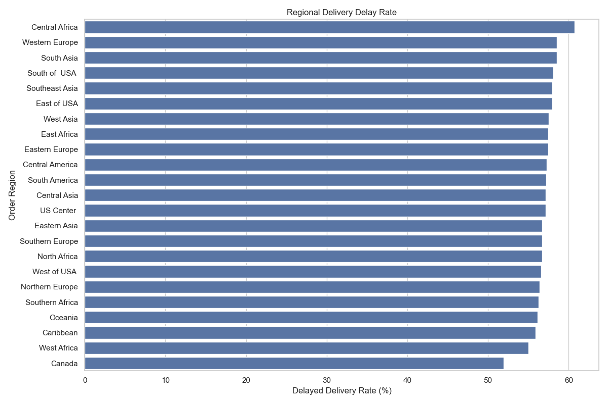
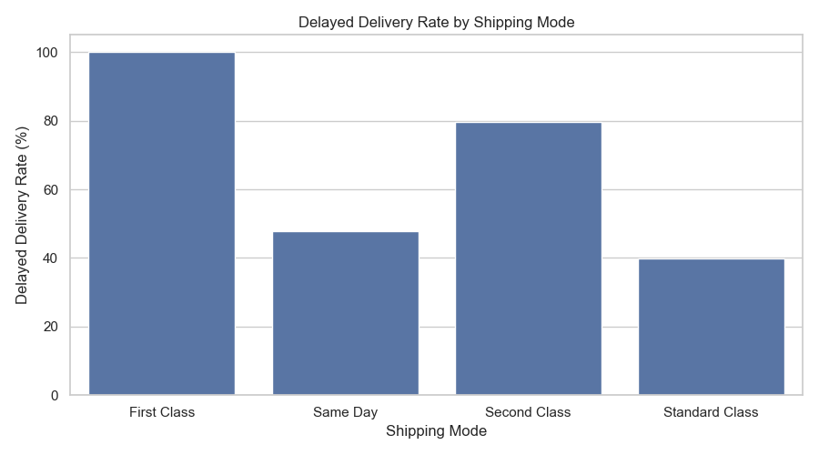

# Delivery Performance Analysis

### Delivery Performance, Delay Risk & Logistics Efficiency

An end-to-end Data Analytics project that investigates delivery performance, shipping efficiency, regional delays and customer segments using Python and Streamlit.

##  Project Overview

This project analyzes approximately 180,519 logistics records to identify delivery delays, evaluate shipping performance and understand operational inefficiencies.

The objective is to transform raw logistics data into meaningful business insights through data cleaning, exploratory data analysis, KPI development and interactive visualization.

##  Project Objectives

- Analyze overall delivery performance.
- Identify early, on-time and delayed deliveries.
- Evaluate shipping mode efficiency.
- Compare delivery performance across regions and markets.
- Analyze customer segment performance.
- Identify potential delivery delay risks.
- Build an interactive analytics dashboard.

##  Technologies Used

| Technology | Purpose |
|---|---|
| Python | Data analysis |
| Pandas | Data manipulation |
| NumPy | Numerical operations |
| Matplotlib | Data visualization |
| Streamlit | Interactive dashboard |
| Git & GitHub | Version control |

## Key Performance Indicators

The analysis generated the following KPIs:

| KPI | Result |
|---|---:|
| Total Records | 180,519 |
| Early Deliveries | 43,366 |
| Exactly On-Time Deliveries | 33,753 |
| Delayed Deliveries | 103,400 |
| On-Time Delivery Rate | 42.72% |
| Delayed Delivery Rate | 57.28% |
| Average Delivery Gap | 0.57 days |
| Average Delay Among Delayed Records | 1.62 days |
| Late Delivery Risk Indicator | 54.83% |

##  Key Analysis Areas

### 1. Delivery Performance
Analyzed early, on-time and delayed delivery classifications.

### 2. Shipping Mode Analysis
Compared delivery performance across:
- First Class
- Second Class
- Standard Class
- Same Day

### 3. Regional Analysis
Evaluated delivery delays across different geographical regions.

### 4. Market Analysis
Compared delivery performance across global markets.

### 5. Customer Segment Analysis
Analyzed Consumer, Corporate and Home Office segments.

##  Interactive Dashboard

Developed an interactive Streamlit dashboard featuring:

- Delivery performance overview.
- Delay risk analysis.
- Shipping mode performance.
- Regional delay analysis.
- Market-level analysis.
- Customer segment analysis.
- Interactive filters.

##  Project Structure

```text
Delivery_Performance_Analysis/
│
├── analysis/
│   ├── 01_data_inspection.py
│   ├── 02_data_cleaning.py
│   ├── 03_kpi_analysis.py
│   ├── 04_visualizations.py
│   ├── 05_check_columns.py
│   └── 06_research_analysis.py
│
├── dashboard/
│   └── app.py
│
├── dataset/
│
├── research_paper/
│   └── results/
│
├── visualizations/
│
├── videos/
│
└── .gitignore
```

## 🚀 How to Run the Project

### Step 1: Clone the repository

```bash
git clone https://github.com/Siddeshmachani/Delivery-Performance-Analysis-2026.git
```

### Step 2: Navigate into the project

```bash
cd Delivery-Performance-Analysis-2026
```

### Step 3: Install dependencies

```bash
pip install pandas numpy matplotlib streamlit
```

### Step 4: Run the dashboard

```bash
streamlit run dashboard/app.py
```

**Note:** The original and cleaned datasets are excluded from this public-facing project repository. You will need to supply the required dataset files locally before running the analysis and dashboard.

##  Business Insights

This project helps identify:

- The proportion of delayed deliveries.
- Differences in shipping mode performance.
- Regional delivery inefficiencies.
- Customer segment delivery patterns.
- Opportunities to improve logistics operations.

##  Author

**Siddesh Machani**

GitHub: [@Siddeshmachani](https://github.com/Siddeshmachani)

---

⭐ If you find this project interesting, consider giving the repository a star!
---

## Dashboard Preview

### 1. Delivery Performance Overview


### 2. Delay Risk Analysis


### 3. Shipping Mode Comparison


### 4. Regional & Market Analysis


---

## 📈 Data Visualizations

### Delivery Classification


### Delivery Gap Distribution


### Regional Delay Analysis



### Shipping Mode Performance
